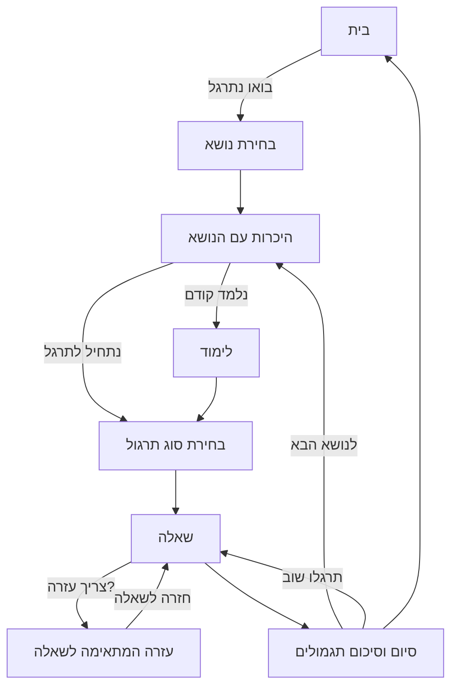
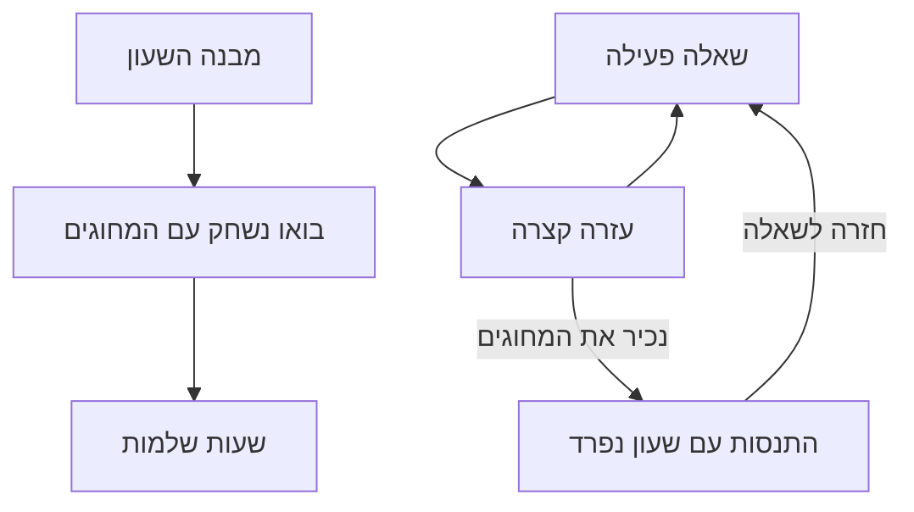
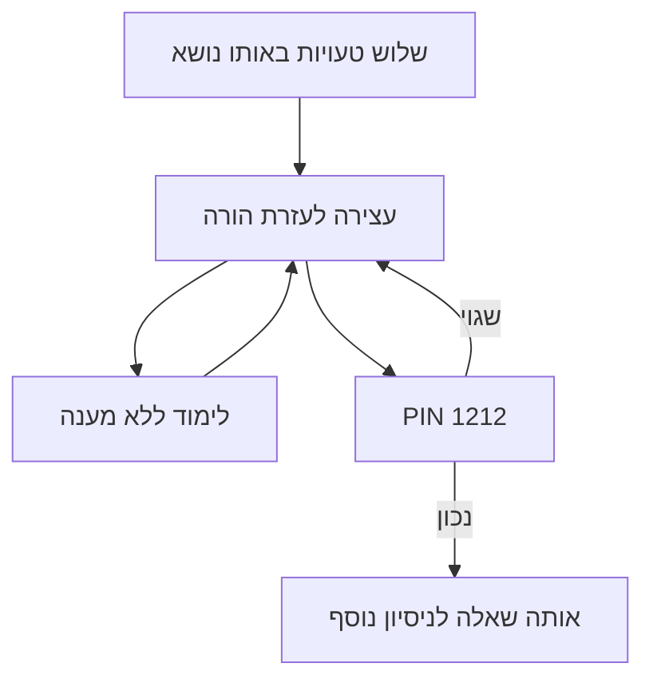

# גרסת ניסיון לילד — בחינת Flow ודוח קבלה

תאריך: 17 באוקטובר 2026. בסיס: main ב־`2d326a8` (PR #49).
משימות: #24, #27, #50, #51. אישור מימוש ניתן בשיחה; מיזוג ופרסום דורשים אישור נפרד לאחר הדוח.

## ממצאי #51 וההתנסות

ברכיב הקודם `AnalogClock`, מצב `onHourChange` אפשר גרירת שעות בלבד; מצב `onTimeChange` אפשר גרירת דקות בלבד והזיז שעות אוטומטית. לא הייתה אפשרות לבחור ולגרור את שני המחוגים באותו מסך.

המיקום שאושר הוא בתחילת ״מבנה השעון״, מיד לאחר היכרות עם המחוגים. התווסף מצב אופציונלי `bothHands`; מצבי התרגול וכללי ההצמדה הקודמים אינם משתנים.

- גרירת שעות: כל מעלה היא שתי דקות; סיבוב מלא הוא 12 שעות. שני המחוגים נשארים קשורים לזמן אחד.
- גרירת דקות: כל מעלה היא שישית דקה; סיבוב מלא הוא שעה. הסנכרון מתעדכן גם במעבר דרך 12 ובכיוון ההפוך.
- ההתנסות מוצמדת לדקה אחת. חצי/רבע/חמש דקות בתרגולים שומרים על ההצמדה שלהם.
- מקלדת: חצים על הקצר מזיזים שעה ומשאירים את הדקות; על הארוך מזיזים דקה. Home/End זמינים. יש תוויות נגישות וידיות אחיזה נפרדות עם אזורי מגע מורחבים.
- השעה הדיגיטלית גלויה ב־LTR. אין בדיקת תשובה, תגמולים או ספירת טעויות.

## המסלול המרכזי שנוסף

מבנה השעון הוא לימוד והתנסות בלבד, עם מעבר לשעות שלמות. בנושא האחרון מוצג ״בחירת נושא״ במקום ״לנושא הבא״. מעבר לנושא אינו פותר שאלות ואינו מתחיל רצף תגמולים חדש.

## שימור ואיפוס

| מעבר | התנהגות |
|---|---|
| שאלה → עזרה → שאלה | רכיב השאלה נשאר mounted; מחוגים, בחירות, משוב ונעילה נשמרים. התגמולים והמונים נשארים משותפים ועדכניים. |
| תרגול במסלול המרכזי → בית → המשך | תרגול פעיל אחד נשמר בזיכרון. |
| בחירת תרגול אחר | אישור לפני החלפת תרגול שלא הסתיים. תגמולים, מונים ועצירות נשמרים. |
| התחלה מחדש | כרגיל: מצב שאלה התחלתי ורצף תגמולים חדש; הסכומים והעצירות נשמרים. |
| רענון | אין שמירה חדשה של השאלה או המחוגים. נשמרים רק הנתונים שהיו עמידים קודם: תגמולים, Baseline, היום שלי ועצירות. |
| איפוס תגמולים מוצלח באזור ההורה | לאחר שמירה מוצלחת בלבד מתבטל גם התרגול המושהה במסלול המרכזי. כשל או ביטול אינם מבטלים אותו. |
| עזרה בזמן עצירה | חזרה לאותה עצירה; רק PIN פותח אותה. |

עזרה בדוגמה אחרת אינה רושמת ניסיון ואינה מעניקה תגמול. בשעוני השאלות נבחרת שעה אחרת לדוגמת העזרה. בזמן יחסי ההסבר מותאם לזמן שעבר/נותר ולשלב החישוב; בחלקי היום לזיהוי/השוואה.

## שמות #27

- קפיצות של 5 דקות — בין מספר למספר בשעון עוברות 5 דקות.
- צעדים של דקה אחת — בין שני סימונים קטנים בשעון עוברת דקה אחת.

עודכנו כניסות, כותרות והמלצת Baseline. נתונים שמורים וכללי המלצה לא השתנו.

## היקף ומגבלות למסירה

המסלול המרכזי החדש הוא ״בואו נתרגל״. קישורי הלימוד הישנים נשמרו תחת ״לימוד לפי נושא״ לצורך תאימות. גם בתרגולים שנפתחים מהם קיימת העזרה החדשה, אבל היציאה לבית במסלול הישן עדיין משתמשת בהתנהגות הקודמת: אינה שומרת את השאלה כתרגול הפעיל של המסלול המרכזי. גם פעולת ״לנושא הבא״ משולבת במסלול המרכזי בלבד. זהו פער פתוח מול אחידות ה־Flow המלאה ב־#50, ויש להחליט על השלמת איחוד המסלולים לפני סגירת #50.

ב״היום שלי״ קיימת אזהרה ביציאה לבית, בביטול ובפתיחת טופס חדש לאחר שינוי. החלפת פעילות לעריכה/מחיקה מתוך רשימת הפעילויות בזמן שטופס אחר שונה דורשת הרחבת ההגנה; אין להציג זאת כהגנה מלאה על כל פעולה.

מגבלות נוספות: לשונית פעילה אחת; שמירה מקומית בלבד; שינוי שלא נשמר עקב כשל אחסון עלול ללכת לאיבוד. אין אימות במכשירים פיזיים, Safari/WebKit, Firefox או קורא מסך. נדרשת בדיקה במכשיר שבו הילד ישתמש.

## סבבי בדיקה

1. רגרסיה ראשונית: 235 מתוך 245 עברו. עשרה כשלים בציפיות הישנות: שמות, סיומי שיעורים, כפתורי בית ובחירת שעון הדגמה לאחר הוספת ההתנסות. עודכנו בדיקות והתנהגות סיום בלי להחליש בדיקות דיוק.
2. שילוב: 250 מתוך 253 עברו. שלושה כשלים שנותרו היו שם נושא והיעדר התקדמות מספרית בשעות שלמות. תוקנו. בדפדפן נבדקו 120 מסלולי עזרה: כל 20 מצבי התרגול בשישה גדלים, עם שימור מצב/אחסון, ללא שגיאות runtime או גלישה אופקית; גם המשך דרך הבית ו־Back מעזרה עברו.
3. אימות אחרון: 253 מתוך 253 בדיקות עברו בפקודה הרגילה, ב־21 קבצים, 49.49 שניות; ללא שינוי timeouts. תוצאות הדפדפן הסופיות מפורטות בתיאור ה־PR.

## המלצת קבלה

לא למזג או לפרסם אוטומטית. יש פערים ידועים באיחוד המסלולים ובהגנת טופס, ולכן אין להציג את #50 כמושלם או את כלל גרסת הניסיון כמוכנה ללא הסתייגות. בהתאם למגבלת שלושת הסבבים, מגישים PR ודוח לביקורת ועוצרים לפני מיזוג. אין סבב רביעי ללא אישור.

לאחר אישור מיזוג עתידי: למזג עם expected head SHA, לוודא Actions מוצלח עבור commit המיזוג, לבצע בדיקת עשן בגרסה החיה, ורק אז למחוק את הענף. אין למחוק ענף עם עבודה שלא מוזגה.

האימות הסופי בדפדפן עבר שוב 120 מסלולי עזרה בשישה גדלים: 1280×900, 390×844, 844×390, 768×1024, 1024×768, 320×568. בנוסף עברו: גרירת שעות בעכבר, גרירת דקות ושעות במגע מדומה, עזרה בזמן עצירת הורה, PIN שגוי/נכון, איפוס תגמולים שנכשל תוך שימור התרגול המושהה, והגנת טופס ביציאה לבית. לא נרשמו שגיאות runtime. צילומי מסך של ההתנסות והבית בנייד נבדקו חזותית. בדיקת העכבר התחילה אחרי גלילה מפורשת לשעון; ניסיון ראשוני לפני הגלילה לא היה בדיקת גרירה תקפה.

בבדיקת ענפים מרוחקים לפני העלאת ענף העבודה נמצא רק main. אין ענפים ישנים נוספים למחיקה. ענף העבודה הנוכחי מכיל עבודה שטרם מוזגה ויש לשמור אותו.
